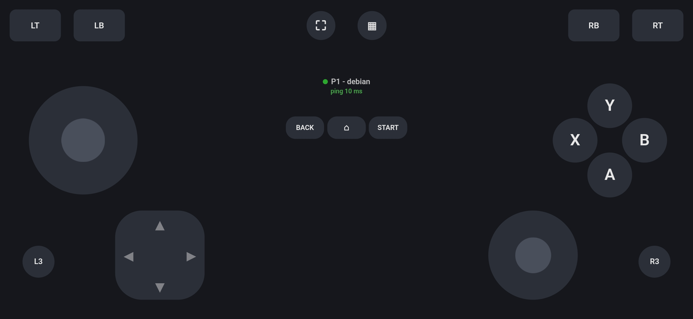
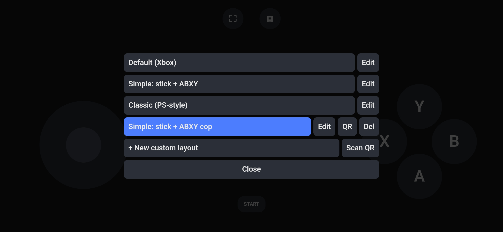

# MashPad

Turn your phone into a gamepad over your LAN. Scan a QR code, get a virtual Xbox 360 controller on your Linux machine. Works on Wayland and X11.

<p>
  
  
</p>

## Install

Debian and Debian-based distros (Ubuntu, Mint, ...):

```bash
git clone https://github.com/ZarvanGrace/MashPad.git
cd MashPad
./install.sh
```

It installs the needed packages (asks for sudo), sets up `/dev/uinput` access, creates a venv in `~/.local/share/mashpad` and adds the `mashpad` command. If the command isn't found, log out and back in once.

## Use

```bash
mashpad
```

Scan the QR code with your phone (same Wi-Fi). A controller appears when a phone joins and disappears when it leaves. `Ctrl+C` stops the server.

## Config

Edit `~/.local/share/mashpad/config.json`, then restart.

| Setting | Default | |
|---|---|---|
| `port` | `4040` | Server port |
| `max_players` | `4` | Max phones (1 to 16) |
| `https` | `false` | Self-signed HTTPS (needs `openssl`) |
| `persistent_pads` | `false` | Create all pads at startup. Use this if a game never notices new controllers, and start MashPad **before** the game |
| `leave_grace` | `8` | Seconds a dropped phone keeps its pad |
| `stick_deadzone` | `0.05` | Hides finger jitter near the centre |
| `stick_smoothing` | `1.0` | 0 = off, higher = smoother but laggier |

## Problems

- **"Can't create virtual gamepads"**: `sudo modprobe uinput`, then check `ls -l /dev/uinput`. Over SSH, the installer's rule doesn't apply; use `sudo chmod 666 /dev/uinput`.
- **Phone can't connect**: same network? Guest Wi-Fi often blocks device-to-device traffic. Firewall? `sudo ufw allow 4040/tcp`. Restarted MashPad? Scan the new QR code.
- **Lag or freezes**: turn off Wi-Fi power saving. MashPad prints the exact commands at startup if it's on.

## Manual install / uninstall

No script? Install `python3 python3-venv python3-dev build-essential`, then:

```bash
python3 -m venv venv && . venv/bin/activate
pip install -r requirements.txt
python3 app.py
```

Uninstall with `./uninstall.sh` from the cloned folder.

## License

MIT, see [LICENSE](LICENSE). Bundles two libraries in `js/`, unmodified:

- [qrcode-generator](https://github.com/kazuhikoarase/qrcode-generator) by Kazuhiko Arase, MIT
- [jsQR](https://github.com/cozmo/jsQR) by Cosmo Wolfe and contributors, Apache-2.0

License texts are in [THIRD_PARTY_LICENSES.md](THIRD_PARTY_LICENSES.md). "QR Code" is a registered trademark of DENSO WAVE INCORPORATED.
